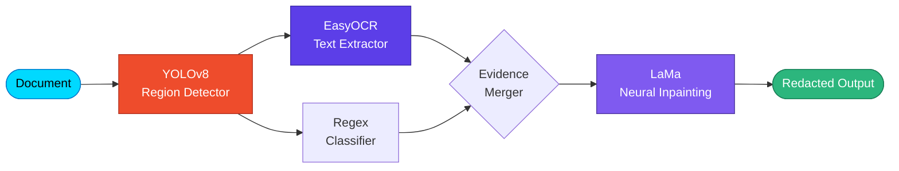
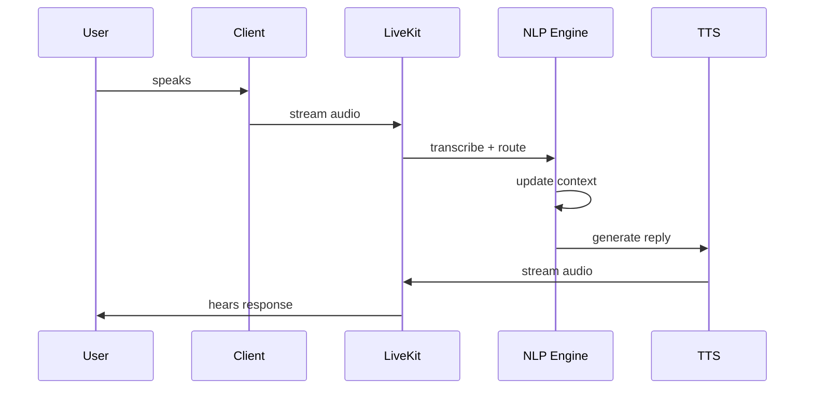
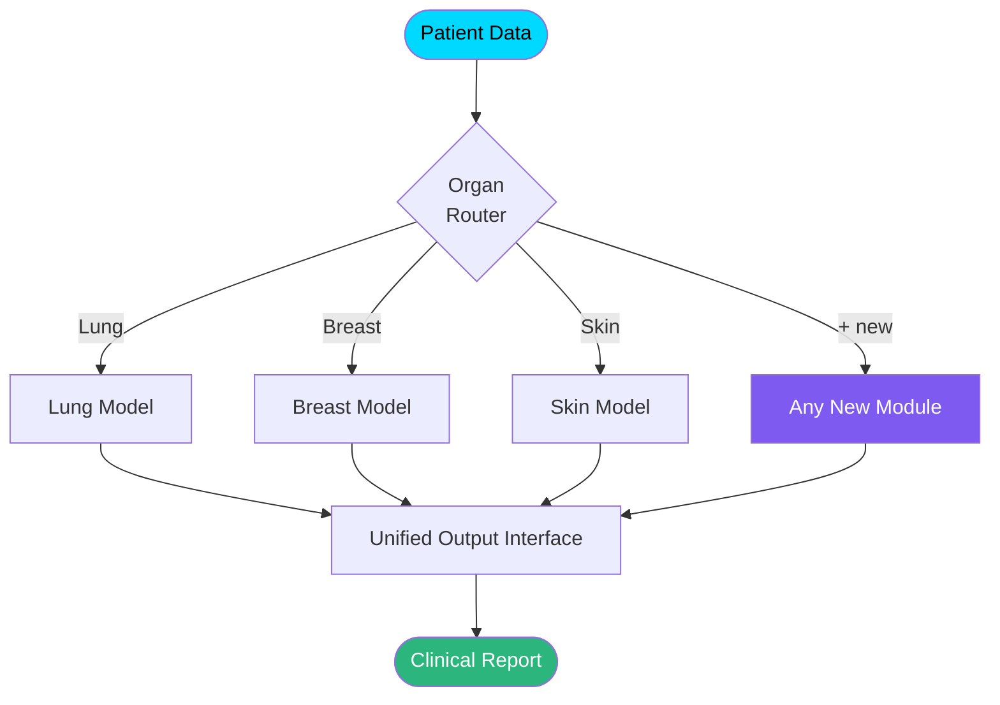
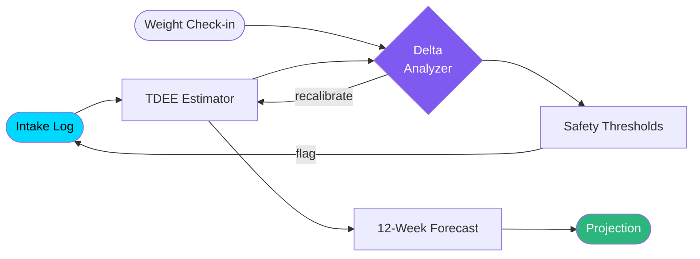
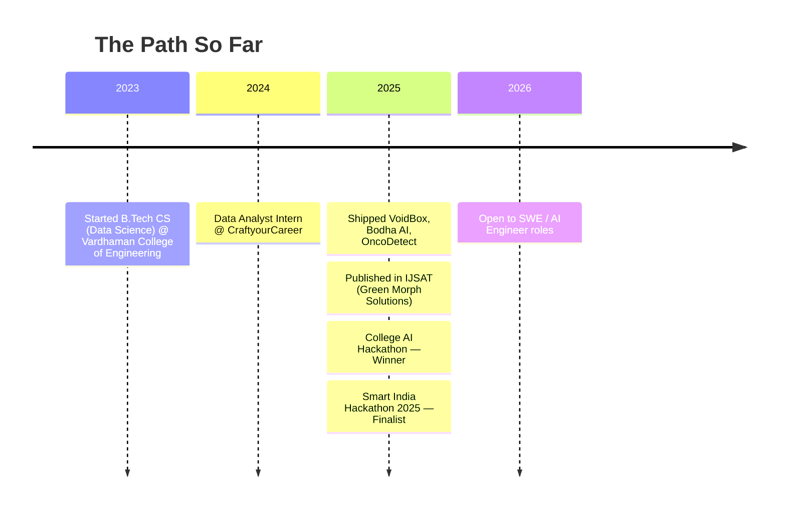

<!-- ══════════════════════════════════════════════════════════════
     HERO
════════════════════════════════════════════════════════════════ -->

<div align="center">
  
</div>

<div align="center">
  
</div>

<div align="center">
  <a href="https://linkedin.com/in/vishva-teja-guduguntla"></a>
  <a href="https://github.com/vishva2410"></a>
  <a href="https://leetcode.com/u/vishva_guduguntla/"></a>
  <a href="mailto:vishvateja10@gmail.com"></a>
  
</div>

<br>

> ### "The model is the easy part. Making it run in 200ms on a CPU, inside someone else's office, with their data never leaving the room — *that's* the job."

<div align="center">
  
  
  
</div>

<br>

<div align="center">

| 🎯 **Focus** | 🧪 **Experimenting** | 📚 **Reading** | ☕ **Fuel** |
|:---:|:---:|:---:|:---:|
| Inference optimization | Agentic RAG pipelines | *Designing Data-Intensive Applications* | Lo-fi + rain |

</div>

<div align="center">
  
  
  
  
</div>


<!-- ══════════════════════════════════════════════════════════════
     CURRENT STATUS
════════════════════════════════════════════════════════════════ -->

### `~/current-status`

vishva@dev ~ % ./status.sh

  ▶ ROLE      B.Tech CS (Data Science) · Vardhaman College of Engineering
  ▶ FOCUS     Local-first AI · Inference optimization · Modular backends
  ▶ SHIPPING  VoidBox v2 · Bodha AI · OncoDetect modules
  ▶ READING   Designing Data-Intensive Applications
  ▶ MOOD      caffeine.pid [running] ████████████░ 92%


<!-- ══════════════════════════════════════════════════════════════
     MANIFESTO
════════════════════════════════════════════════════════════════ -->

## 🧭 How I Think

- **Latency is a feature.** Sub-2s isn't a benchmark — it's the line between a tool people use and one they abandon.
- **Local beats cloud when data is sensitive.** Not every problem should be an API call.
- **Modularity is a kindness.** Onboarding a new capability shouldn't require touching the core.
- **False negatives are worse than false positives** — especially in PII and clinical pipelines.
- **Ship. Then optimize.** A working prototype teaches more than a perfect plan.


<!-- ══════════════════════════════════════════════════════════════
     FEATURED BUILDS
════════════════════════════════════════════════════════════════ -->

## ⚡ Featured Builds

<details open>
<summary><h3>🔒 VoidBox — Privacy-First PII Redaction Engine</h3></summary>

> **Problem.** Compliance-sensitive documents can't leave the building. Cloud OCR is a non-starter.
> **Build.** A fully local pipeline that detects & redacts **11+ PII categories** without a single network call.

**⚙️ Architecture**



**📊 Benchmarks**

| Metric | Result |
|---|---|
| Inference (CPU) | **< 2s / image** |
| PII categories | **11+** |
| False negatives | **0** across 200-doc set |
| Cloud dependency | **None** |

**🧠 Hard parts solved**
- Tuning OCR + regex fusion so overlapping detections don't double-redact
- Getting LaMa to inpaint *legibly* on dense text regions
- Keeping the whole thing CPU-bound so it runs on the user's laptop

`PyTorch` `YOLOv8` `EasyOCR` `LaMa` `OpenCV`

[**→ Browse the repo**](https://github.com/vishva2410/VOID-BOX)

</details>

---

<details open>
<summary><h3>🎙️ Bodha AI — Real-Time Conversational Voice Assistant</h3></summary>

> **Problem.** Real conversation needs < 300ms round-trip — anything slower feels like talking to a transcript.
> **Build.** A streaming voice AI engine on live audio protocols, with multi-turn context that doesn't fall apart after turn three.

**⚙️ Sequence**



**📊 Benchmarks**

| Metric | Result |
|---|---|
| End-to-end latency | **< 300ms** |
| Conversation continuity | **95%+** |
| Transport | LiveKit + WebSockets |
| Context model | Multi-turn NLP |

**🧠 Hard parts solved**
- Keeping streaming stable across packet jitter
- Keeping context coherent without ballooning token cost
- Synchronizing TTS playback with barge-in

`LiveKit` `WebSockets` `NLP` `Python`

[**→ Browse the repo**](https://github.com/vishva2410/bodha_ai_1)

</details>

---

<details>
<summary><h3>🩺 OncoDetect — Modular Cancer Diagnostic Pipeline</h3></summary>

> **Problem.** Every hospital wants a "cancer AI," but every organ gets its own bespoke pipeline. That doesn't scale.
> **Build.** A plug-and-play diagnostic framework where adding a new organ module requires **zero** changes to the core pipeline.

**⚙️ Architecture**



**🧠 Hard parts solved**
- Unified prediction contract so new modules "just fit"
- End-to-end clinical report generation from raw model outputs
- Outputs structured to be consumed by downstream reporting tools

`PyTorch` `FastAPI` `Computer Vision`

[**→ See on GitHub**](https://github.com/vishva2410)

</details>

---

<details>
<summary><h3>🔥 DynaCalorie AI — Adaptive Metabolic Engine</h3></summary>

> **Problem.** Every TDEE calculator lies — because human metabolism drifts.
> **Build.** A tracker that learns from its own prediction errors and recalibrates bi-weekly.

**⚙️ Feedback Loop**



**📊 Benchmarks**

| Metric | Result |
|---|---|
| Accuracy vs. static TDEE | **+12% over 12 weeks** |
| Recalibration cadence | Bi-weekly |
| Safety | Flags unhealthy loss rates & low protein |

`Python` `Forecasting` `Health ML`

[**→ Browse the repo**](https://github.com/vishva2410/Dyna-Calorie)

</details>


<!-- ══════════════════════════════════════════════════════════════
     TECH RADAR
════════════════════════════════════════════════════════════════ -->

## 🛰️ Tech Radar

<div align="center">
  
</div>

<table>
<tr>
<td width="50%" valign="top">

**🧬 AI / ML**
- PyTorch · TensorFlow · scikit-learn
- Computer Vision · YOLOv8 · OpenCV · EasyOCR
- NLP · LLMs · multi-turn context
- LaMa inpainting · segmentation

</td>
<td width="50%" valign="top">

**⚙️ Backend & Infra**
- FastAPI · Flask · REST · WebSockets · LiveKit
- Docker · AWS (EC2, S3) · Linux
- PostgreSQL · MySQL · Pandas · NumPy
- Git · Postman · Tableau

</td>
</tr>
</table>


<!-- ══════════════════════════════════════════════════════════════
     LIVE METRICS
════════════════════════════════════════════════════════════════ -->

## 📈 Live Metrics

<div align="center">
  
  
</div>

<div align="center">
  
</div>

<div align="center">
  
</div>

<div align="center">
  
</div>

<!-- 🐍 OPTIONAL: snake animation
     Setup → https://github.com/Platane/snk (add the provided workflow, then uncomment)

<picture>
  <source media="(prefers-color-scheme: dark)"  srcset="https://raw.githubusercontent.com/vishva2410/vishva2410/output/github-snake-dark.svg" />
  <source media="(prefers-color-scheme: light)" srcset="https://raw.githubusercontent.com/vishva2410/vishva2410/output/github-snake.svg" />
  
</picture>
-->


<!-- ══════════════════════════════════════════════════════════════
     TIMELINE
════════════════════════════════════════════════════════════════ -->

## 🗺️ Timeline




<!-- ══════════════════════════════════════════════════════════════
     RECEIPTS
════════════════════════════════════════════════════════════════ -->

## 🏆 Receipts

| Type | Detail |
|---|---|
| 📄 **Publication** | *Green Morph Solutions* — IJSAT Vol. 16, Issue 2 · [DOI: 10.71097/IJSAT.v16.i2.4382](https://doi.org/10.71097/IJSAT.v16.i2.4382) |
| 🥇 **Win** | College-level AI Hackathon |
| 🚀 **Finalist** | Smart India Hackathon 2025 |
| 🎤 **Debate** | 10+ tournament wins — pressure-tested reasoning |
| 💼 **Industry** | CraftyourCareer — cut bounce rate **18%** with engagement analytics |
| 🧮 **DSA** | **600+** problems solved (LeetCode 310 · GFG 212 · Codeforces · college platform) |


<!-- ══════════════════════════════════════════════════════════════
     CTA
════════════════════════════════════════════════════════════════ -->

## 💬 Let's Talk

Whether it's inference latency, privacy-first AI, or just interesting systems — my inbox is open.

<div align="center">
  <a href="mailto:vishvateja10@gmail.com"></a>
  <a href="https://linkedin.com/in/vishva-teja-guduguntla"></a>
</div>

<br>

<div align="center">
  <sub>⭐ If any of my repos helped you, a star goes a long way.</sub>
</div>

<div align="center">
  
</div>
```
